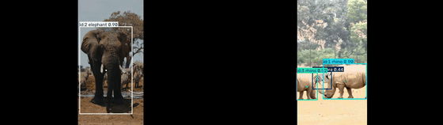

# 아프리카 야생동물 3종 객체 감지 및 추적



YOLO로 3개 부류(elephant, zebra, rhino)를 학습하고, 학습한 모델로 영상 속 객체를 감지·추적한 결과입니다.
고화질 영상: [video/result.mp4](video/result.mp4)
입력 영상: 동물별 영상 2개(elephant,zebra.mp4, rhino,zebra.mp4)를 한 화면에 나란히 합친 5초 영상

## 결과 요약

- 최종 모델: `yolo26n` → [weights/yolo26n_best.pt](weights/yolo26n_best.pt)
- 추적기: `bytetrack` (고유 ID 5개, 150프레임 = 약 5.0초)
- 평가 데이터: 학습에 쓰지 않은 `test` 분할

| 모델 | 평가 분할 | Precision | Recall | mAP50 | mAP50-95 | 추론(ms/장) | 가중치(MB) |
| --- | --- | --- | --- | --- | --- | --- | --- |
| yolov8n | test | 0.9747 | 0.9423 | 0.9786 | 0.828 | 2.2949 | 6.1947 |
| yolo26n | test | 0.976 | 0.9428 | 0.9813 | 0.8529 | 2.6364 | 5.1929 |

## 데이터셋

| 분할 | 이미지 | 빈 라벨(배경) | 라벨 파일 없음 | elephant 박스 | zebra 박스 | rhino 박스 |
| --- | --- | --- | --- | --- | --- | --- |
| train | 791 | 0 | 0 | 558 | 575 | 399 |
| val | 165 | 0 | 0 | 91 | 114 | 85 |
| test | 178 | 0 | 0 | 99 | 135 | 75 |

- Ultralytics 공개 데이터셋 [african-wildlife](https://docs.ultralytics.com/datasets/detect/african-wildlife/)에서 elephant, zebra, rhino 부류만 골라 사용했습니다(촬영·라벨링 없이 공개 라벨 사용).

## 학습

| 모델 | 설정 에폭 | 실제 에폭 | 최고 에폭 | 학습 시간(분) | 장치 |
| --- | --- | --- | --- | --- | --- |
| yolov8n | 100 | 100 | 94 | 10.4 | NVIDIA GeForce RTX 4060 Laptop GPU (8.0GB) |
| yolo26n | 100 | 100 | 90 | 13.8 | NVIDIA GeForce RTX 4060 Laptop GPU (8.0GB) |

- 사전학습(COCO) 가중치에서 전이학습, imgsz=640, batch=16, patience=30
- 환경: ultralytics 8.4.215, torch 2.15.0+cu132, NVIDIA GeForce RTX 4060 Laptop GPU (8.0GB)
- 학습 곡선과 혼동행렬: [results/](results/)

## 추적

같은 구간에 추적기 3개를 돌려 비교했습니다. 추적률은 탐지된 박스(conf≥0.25) 대비 ID가 붙은 박스의 비율입니다.

| 추적기 | 고유 ID 수 | 추적률 | 프레임당 최대 객체 | 처리 속도(FPS) |
| --- | --- | --- | --- | --- |
| bytetrack.yaml | 5 | 1.008 | 4 | 37.7 |
| botsort.yaml | 5 | 1.012 | 4 | 27.4 |
| tracktrack.yaml | 3 | 0.902 | 3 | 26 |

- 이동 궤적: [tracking/trajectory.png](tracking/trajectory.png), 프레임별 좌표: [tracking/trajectory.csv](tracking/trajectory.csv)

## 실행 방법

```bash
pip install -r requirements.txt
python track.py --weights weights/yolo26n_best.pt --source 내영상.mp4 --tracker bytetrack.yaml --seconds 5
```

## 폴더 구조

```
weights/   학습된 모델(best.pt)
results/   학습 곡선, 혼동행렬, 성능 표
video/     추적 결과 영상(mp4, gif)
tracking/  궤적 그림, 좌표 CSV, 추적기 비교
data/      부류 정보(data.yaml)
track.py   추적 실행 스크립트
```

## 라이선스

Ultralytics YOLO(AGPL-3.0) 코드와 모델을 사용했습니다.
